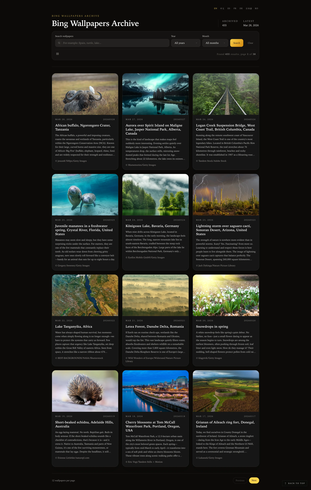
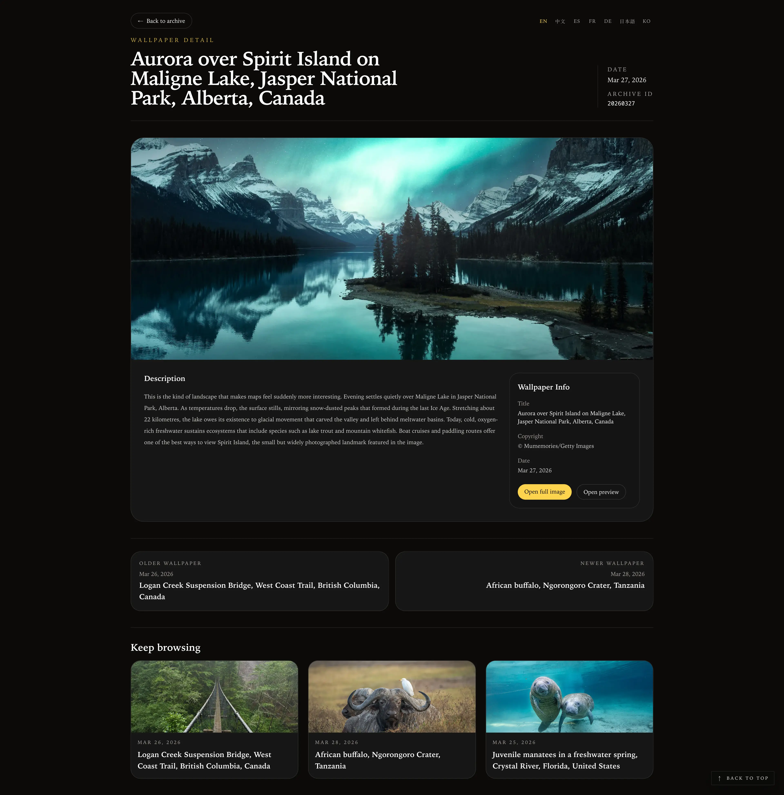

# Bing Wallpapers Archive

A multilingual Bing wallpaper archive built with Next.js, TypeScript, and an external DB repository.

Online preview: [https://bing.xc2f.com](https://bing.xc2f.com)

## Overview

This project archives Bing wallpapers locally and presents them through a unified gallery and detail pages:

- Continuous waterfall gallery on the homepage
- Image slideshow preview
- Wallpaper detail

It supports locale-aware routing, direct Bing image loading, advanced search, and Cloudflare deployment via OpenNext.

## Features

- Unified waterfall homepage, slideshow previews, and detail pages
- Year and month filtering
- Locale-aware UI routing
- Dynamic detail-page ambient background based on wallpaper tones
- Images loaded directly from Bing without application-side image caching
- Build-time JSON sync from external DB repository

## Advanced Search

Supported patterns:

- `bird fish`  
  Match the full phrase.
- `bird, fish`  
  Match any comma-separated clause.
- `lake -night`  
  Exclude results containing `night`.
- `title:bird`
- `desc:turtle`
- `copyright:spain`
- `date:2024`
- `ssd:20241229`
- `date:2026-10-01..2026-10-31`
  Match an inclusive date range using archive dates, independently of locale. Compact dates (`20261001`), month/year bounds (`date:2026-10..2026-11`), and open bounds (`date:2026-10-01..` or `date:..2026-10-31`) are also supported.
- `(title:lake OR title:forest) AND date:2026-10-01..2026-10-31 AND NOT city`
  Combine conditions with uppercase `AND`, `OR`, `NOT` and parentheses. `NOT` binds first, then `AND`, then `OR`. Commas also mean `OR`; adjacent fields or groups imply `AND`. Adjacent plain words retain phrase matching. Quote values containing spaces, commas, parentheses or operator words, e.g. `title:"Lake Bled"`.

Search date ranges intersect the year/month controls and other filters. Invalid dates, reversed intervals and malformed expressions return no matches.
Whitespace after a field colon is optional: `title:lake` and `title: lake` are equivalent, as are `title:"Lake Bled"` and `title: "Lake Bled"`.

Press `?` in the search box to open the built-in search help panel.

## Internationalization

Supported locales:

- `en`
- `zh`
- `es`
- `fr`
- `de`
- `ja`
- `ko`

The default locale is `en`, and the app remembers the user’s selected language.

## Images

Images are loaded directly from Bing using absolute URLs generated by [`lib/archive.ts`](./lib/archive.ts). The app does not proxy or cache image bytes in Cloudflare R2.

`next/image` uses unoptimized mode to request Bing URLs directly, without `/_next/image`. Image elements omit the referrer, and ambient color sampling uses anonymous CORS with a fallback background when Bing does not allow pixel access.

## Tech Stack

- Next.js 15 App Router
- React 19
- TypeScript
- Tailwind CSS
- OpenNext Cloudflare

## Design Style

现有界面的设计原则、双主题色彩、字体、布局、组件和动效约定见 [设计风格文档](./docs/design-style.md)。后续界面任务也可读取仓库内的 [bing-wallpapers-design skill](./skills/bing-wallpapers-design/SKILL.md)。

## Project Structure

- [`app/[locale]/page.tsx`](./app/[locale]/page.tsx)  
  Unified waterfall homepage
- [`app/[locale]/wallpaper/[ssd]/page.tsx`](./app/[locale]/wallpaper/[ssd]/page.tsx)  
  Wallpaper detail page
- [`app/[locale]/waterfall/page.tsx`](./app/[locale]/waterfall/page.tsx)  
  Legacy waterfall URL redirect
- [`bin/sync-db.ts`](./bin/sync-db.ts)  
  Build-time external DB sync

## Local Development

Install dependencies:

```bash
npm install
```

Create `.env`:

```bash
BASE_URL=https://www.bing.com
```

Start the dev server:

```bash
npm run dev
```

Open [http://localhost:3000](http://localhost:3000).

## SEO

Canonical URLs, language alternates, social sharing metadata and JSON-LD are generated on the server. The archive exposes `/robots.txt` and `/sitemap.xml`, including all wallpaper details and the homepage in every supported language.

Set `SITE_URL=https://bing.xc2f.com` to the public site origin when deploying on a different domain. This is separate from `BASE_URL`, which configures the Bing image host. Rebuild after changing the origin or archive data to refresh the sitemap.

Search and date-filtered archive pages use `noindex,follow`. Gallery batch and display parameters canonicalize to the homepage; detail navigation parameters canonicalize to clean detail URLs.

After deployment, submit `/sitemap.xml` to Google Search Console and Bing Webmaster Tools.

## External DB Repository

If you want to move [`db/`](./db/) into a separate repository, this project now supports pulling the data at build time.

Set these environment variables in GitHub Actions or your deployment environment:

```bash
DB_SYNC_ENABLED=true
DB_SYNC_JSON_URL=https://api.github.com/repos/<owner>/<db-repo>/contents/db/media_contents.json?ref=<branch>
```

If the DB repository is private, also set:

```bash
DB_SYNC_BEARER_TOKEN=<token>
```

The site reads schema version 2: `mediaContents` is an object with `en`, `zh`, `es`, `fr`, `de`, `ja`, and `ko` arrays, alongside `schemaVersion: 2`, `defaultLocale: "en"`, and `fallbackLocale: "en"`.
Each route uses only its language's records for browsing, search, details, and waterfall loading; missing dates are not filled with English records, and empty language archives show an empty state. Records are deduplicated by date (the first eight digits of `Ssd`). Official records take priority over AI translations within a language. Older detail URLs redirect to the selected record for that date when available in that language. Sitemap entries and language alternates follow the available records for each language.

Notes:

- `image_tags.json` uses `schemaVersion: 1`, `taxonomyVersion`, and an `images` object keyed by the wallpaper record’s `imageId`. Each entry contains `category`, `tags`, and an optional `countries` array of country codes. Missing classification records leave wallpapers visible in the unfiltered archive.
- Tags sync alongside the archive. By default, the tags URL is inferred by replacing `media_contents.json` with `image_tags.json` in `DB_SYNC_JSON_URL`. Set optional `DB_SYNC_TAGS_URL` for a different location (required if the archive URL has no such filename).
- Category, tag, and country filters combine with search and date filters, and remain in continuous loading and detail navigation. Related wallpapers prioritize shared tags, then category, then nearby dates. Category and tag names come from `image_tags.json` → `taxonomy.categories` / `taxonomy.tags`; country names come from `taxonomy.country.tags`, keyed by ID and locale. Labels fall back from the current locale to `taxonomy.defaultLocale`, then English, then the raw ID. Name changes take effect after syncing and rebuilding; no site-side translation map needs updating. Interface labels such as “All” and “Expand” remain in the site translations.
- The homepage waterfall gallery carries search, year, month, category, tag, and country filters into batch loading and detail navigation. Its filter panel includes search, a year/month picker, category thumbnails, country/tag rows, removable conditions and a clear-count action. It starts collapsed with active conditions visible and remembers expansion. Clicking an image opens a slideshow preview (paused initially); titles in the gallery and slideshow open the detail page. The gallery loads continuously without pagination controls; `page` in URLs only records the loading batch for restoration. Old `/[locale]/waterfall` links permanently redirect to the homepage with filters and batch preserved. Country and tag rows can individually expand to show all options. Changing the year clears month, category, tag, and country filters; changing the category clears the tag. Filter changes restart loading from the first batch and preserve the image/info display mode.
- `DB_SYNC_JSON_URL` is required because the site reads [`db/media_contents.json`](./db/media_contents.json) directly at build/runtime.
- For GitHub private repositories, prefer the GitHub Contents API URLs above instead of `raw.githubusercontent.com`; they work more reliably with `Bearer` tokens.
- `npm run dev`, `npm run preview`, and `npm run deploy` all sync the DB before starting.

### Migration steps

1. Create a dedicated DB repository and keep these files there:

```text
db/media_contents.json
db/image_tags.json
```

2. In this repository, stop tracking the old DB artifacts:

```bash
git rm --cached db/media_contents.json
git commit -m "Stop tracking local DB artifacts"
```

3. In the main repository GitHub Actions settings, add:

```bash
DB_SYNC_ENABLED=true
DB_SYNC_JSON_URL=https://api.github.com/repos/<owner>/<db-repo>/contents/db/media_contents.json?ref=<branch>
```

4. If the DB repository is private, also add:

```bash
DB_SYNC_BEARER_TOKEN=<token>
```

5. Trigger one deploy to verify the remote DB can be downloaded before deleting local copies anywhere else.

## Trigger Deploy From DB Updates

The DB repository should trigger the main repository's deploy workflow through the GitHub Actions API.

Store a fine-grained GitHub token in the DB repository as:

```bash
TARGET_REPO_WORKFLOW_TOKEN=<token>
```

The token should be allowed to dispatch workflows in the main repository.

Example workflow in the DB repository:

```yaml
name: Notify site deploy

on:
  push:
    branches:
      - main
    paths:
      - "db/**"
  workflow_dispatch:

jobs:
  trigger-deploy-workflow:
    runs-on: ubuntu-latest
    steps:
      - name: Trigger target repository workflow
        run: |
          curl --fail --request POST \
            --url "https://api.github.com/repos/<owner>/<site-repo>/actions/workflows/deploy-on-db-update.yml/dispatches" \
            --header "Accept: application/vnd.github+json" \
            --header "Authorization: Bearer ${TARGET_REPO_WORKFLOW_TOKEN}" \
            --header "X-GitHub-Api-Version: 2022-11-28" \
            --data @- <<JSON
          {
            "ref": "main",
            "inputs": {
              "source_repo": "${GITHUB_REPOSITORY}",
              "source_sha": "${GITHUB_SHA}"
            }
          }
          JSON
        env:
          TARGET_REPO_WORKFLOW_TOKEN: ${{ secrets.TARGET_REPO_WORKFLOW_TOKEN }}
```

Suggested DB repository layout:

```text
.
├── .github/
│   └── workflows/
│       └── notify-pages.yml
└── db/
    └── media_contents.json
```

Recommended split:

- DB repository owns `db/media_contents.json`
- This repository only consumes them during build
- DB repository push -> trigger main repository workflow -> main repository deploys the worker with the latest DB data

## Scripts

- `npm run dev`  
  Start local development
- `npm run build`  
  Production build without DB sync
- `npm run start`  
  Start the production server
- `npm run preview`  
  Sync DB and preview Cloudflare build locally
- `npm run deploy`  
  Sync DB and deploy with OpenNext Cloudflare

## Deployment

This project is deployed as a Cloudflare Worker via OpenNext and GitHub Actions.

Typical flow:

```bash
npm run deploy
```

## Disclaimer

Images are sourced from Microsoft Bing and are used for display purposes only.

All copyrights belong to their respective owners.

This project does not store or redistribute any images.

If there is any infringement, please contact for removal.

## Screenshots






